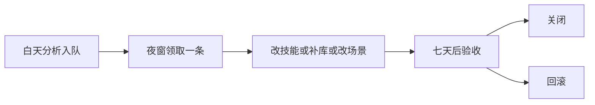

# 学习计划夜跑

白天只把达标信号收成任务；每天本地时间 0:00–5:00 每一拍最多执行一条。执行后挂 7 天后的验收，指标变好则关闭，持平或变差则回滚。同一缺陷（信号类型 + 对象 + `rule_id`）同时只允许一条未关闭任务。

## 增量 1：任务表与夜窗门闩

- 新增 [`backend/models/learning_task.py`](backend/models/learning_task.py)，并在 [`backend/db/__init__.py`](backend/db/__init__.py)、[`backend/db/sqlite_migrate.py`](backend/db/sqlite_migrate.py) 登记。字段：`dedupe_key`、`kind`、`status`、`target_kind`、`target_id`、`baseline_json`、`acceptance_json`、`due_at`、`parent_id`、`evidence_json`、`night_key`。`kind` 为 `patch_skill`、`create_skill`、`fill_kb`、`tune_scenario`、`verify`、`rollback`。`status` 为 `confirmed`、`running`、`verifying`、`done`、`rolled_back`。
- 新服务 [`backend/services/learning_plan_service.py`](backend/services/learning_plan_service.py)：`in_night_window()` 读 `LEARNING_PLAN_WINDOW`（默认 `00:00-05:00`），`LEARNING_PLAN_ENABLED` 默认 true。提升任务时去重。
- 改 [`backend/services/growth_scheduler.py`](backend/services/growth_scheduler.py)：去掉每拍空闲就调用 `evolve_recent`。窗外只跑现有 `analyze_feedbacks` 再入队；窗内才领取。对话、房间或编排在 `SKILL_EVOLUTION_IDLE_SECONDS` 内仍有更新则本拍跳过，任务留在队列，不拖到白天。
- 日志键：`task_id`、`dedupe_key`、`kind`。单测 [`tests/test_learning_plan.py`](tests/test_learning_plan.py)：23:59 不领取，0:00 可领取，5:00 停止，重复信号不插第二条。

## 增量 2：夜里自动改写和新建技能

- 入队规则沿用 [`backend/services/skill_evolution.py`](backend/services/skill_evolution.py) 的 `plan_actions`：`MIN_SUPPORT` 为 2；能对上已有技能则为 `patch_skill`，否则 `create_skill`，名字 `learned_<rule_id>`。两种都直接 `confirmed`，夜窗自动执行。
- 执行只提交这一条，调用现有 `_patch_skill` / `_create_skill`（写入前已有 `_ensure_presnapshot`）。一夜上限沿用 `MAX_ACTIONS`（8）。5:00 后停止领取。
- 成功后父任务改为 `verifying`，插入 `verify`，`due_at` 为 7 天后的夜窗，baseline 记下该场景采纳率或重写次数。
- [`backend/routes/feedback.py`](backend/routes/feedback.py) 的 `POST /learning/evolve` 改为入队，不再立即 `evolve_recent`。`POST /learning/analyze` 仍立即产信号。

## 增量 3：验收与技能回滚

- 夜窗内到期的 `verify` 用同一指标对比 `baseline_json`。变好则父任务 `done`，该 `rule_id` 不再入队。
- 持平或变差：改写走 [`backend/services/skill_lifecycle.py`](backend/services/skill_lifecycle.py) 的 `restore_version`；新建的 `learned_*` 撤下该技能目录与库记录。父任务 `rolled_back`。当夜不再为同一 `rule_id` 写第二条。
- 单测：指标变差后 `SKILL.md` 回到快照。

## 增量 4：skill_underused 生产者

- 在 [`backend/services/learning_service.py`](backend/services/learning_service.py) 的 `analyze_feedbacks` 中补生产者。扫描近 14 天 [`backend/models/orchestration_run.py`](backend/models/orchestration_run.py) 的 `response_metadata_json` / `tool_capture_json` 里的 `skill_calls`。
- 条件：技能已在库中、创建超过 7 天、调用次数为 0、同期已完成编排不少于 5 次。正在 `verifying` 的 `learned_*` 不统计。
- 若某个已发布 [`ScenarioProfile`](backend/models/scenario_profile.py) 的 `skills_policy_json` 点名该技能，入队 `tune_scenario`；没有任何场景点名它，只留开放信号，不改文件。

## 增量 5：fill_kb 执行器

- 已有 `record_kb_miss` 继续产 `kb_miss`。夜跑将其收成 `fill_kb`。
- 写入走 [`backend/services/kb_write.py`](backend/services/kb_write.py) 的 `add_kb_harvest_entry`，集合用信号上的 `collection`，缺省为经验库 `TPD_EXPERIENCE_COLLECTION`，`published=False`。正文只含查询词、命中次数和建议补什么，不覆盖已有知识正文。同步写一条 `ExperienceEntry`，`feedback_id` 可空时用来源任务 id 关联。不走 `save_experience_from_feedback`（那条路径要求反馈行并写图谱）。
- baseline 记下该查询的空命中次数。验收下降则 `done`；否则删除这条未发布条目与对应经验行，父任务 `rolled_back`。

## 增量 6：场景模板

- 场景上的 `repeated_correction`、`low_adoption_scenario`，以及增量 4 里带场景的低使用信号，入队 `tune_scenario`。
- 执行只在 `preset_instructions` 末尾追加一句，`version` 递增，`status` 不变，不改 `domain_json`、`knowledge_policy_json`、`skills_policy_json`。追加前的全文写入 baseline。低使用场景追加的是「优先使用技能 {name}」。
- 验收看该场景采纳率或拒绝次数。变差则把 `preset_instructions` 恢复为 baseline。

## 增量 7：学习中心与周一周报

- `GET /learning/plan` 返回四类任务的对象、验收条件和状态。学习页 [`src/app/learning/LearningPageClient.tsx`](src/app/learning/LearningPageClient.tsx) 增加「学习计划」列表。
- 周一夜跑在领取队列之前调用 `generate_weekly_report`，摘要改为本周四类任务的 `done` 与 `rolled_back`。手动 `POST /learning/reports/weekly` 仍可立即生成。
- 更新 [`guide/API对照表.md`](guide/API对照表.md) 中「系统静默后才复盘」的说明为夜窗执行。

## 完成标准

白天点「复盘对话」只增加队列，不写技能、不写经验库、不改场景。0:00 之后四类任务会被逐条领取。验收失败能回到执行前。周一报告对得上关闭和回滚记录。
